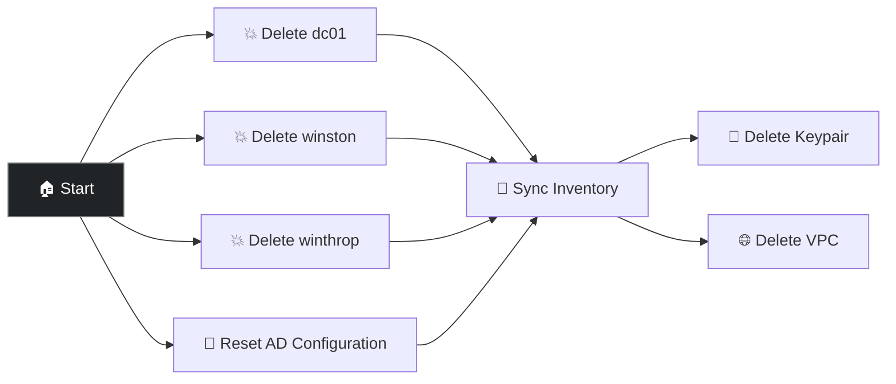

# Destroy Active Directory Domain

Tears down everything created by Setup Active Directory Domain — terminates the domain controller and both domain-joined computers in parallel, resets the Kerberos and AD LDAP credentials to placeholder values, re-syncs the AWS dynamic inventory, and deletes the keypair and VPC.

## Workflow

1. Terminates dc01, winston, and winthrop **in parallel**
2. Resets the Kerberos and AD LDAP credentials to `REPLACEME` placeholders (runs concurrently with the VM deletions since it only touches Controller, not AWS). The AD LDAP inventory source itself is left in place — it's a standing resource referenced directly by the Setup workflow's AD LDAP Inventory Sync node — but with placeholder credentials, it can no longer authenticate against a real domain controller.
3. Syncs AWS inventory so hosts are removed from AAP
4. Deletes keypair `aws-test-key` and VPC `aws-test-vpc` (and related resources: subnet, route table, internet gateway, security group) **in parallel**

## Prerequisites

- An AD domain previously deployed with **Setup Active Directory Domain**
- AWS credential configured
- **AAP Credential** for Controller API callbacks when resetting AD resources

## Survey prompts

| Prompt | Variable | Type | Required |
|--------|----------|------|----------|
| AWS Region | `create_vm_aws_region` | multiplechoice | Yes |

## Job templates

| Template | Playbook | Description |
|----------|----------|-------------|
| Cloud ǀ AWS ǀ Delete Stack VM | [`cloud/delete_vm_by_name.yml`](../../cloud/delete_vm_by_name.yml) | Terminates dc01, winston, and winthrop by Name tag |
| WINDOWS ǀ AD ǀ Reset Configuration | [`windows/reset_ad_configuration.yml`](../reset_ad_configuration.yml) | Resets the Kerberos and AD LDAP credentials to placeholders |
| AWS Inventory | `(inventory sync)` | Re-syncs the AWS dynamic inventory so the deleted hosts are removed from AAP |
| Cloud ǀ AWS ǀ Delete Keypair | [`cloud/delete_keypair.yml`](../../cloud/delete_keypair.yml) | Deletes the `aws-test-key` keypair |
| Cloud ǀ AWS ǀ Delete VPC | [`cloud/delete_vpc.yml`](../../cloud/delete_vpc.yml) | Deletes the VPC and related networking resources |

## Presenter walkthrough

1. **When to use:** Run this at the end of a demo session, or whenever you need a clean slate before running Setup Active Directory Domain again. It's safe to run even if some resources are already gone.
2. **Launch:** Select the same AWS region used for Setup. The workflow handles everything else.
3. **Watch the parallel teardown:** The three VMs terminate simultaneously while the Kerberos and AD LDAP credentials reset to placeholders — no credentials are left pointing at a domain controller that no longer exists.
4. **Wrap-up:** VPC and keypair cleanup happen last, once inventory sync confirms the hosts are gone.

## Talking points

- This is the matching teardown for Setup Active Directory Domain — AAP-side credentials are returned to their pristine, pre-setup state, not left pointing at a terminated domain controller.
- Resetting the Kerberos and AD LDAP credentials to placeholders (rather than leaving them pointing at a deleted domain controller) avoids confusing failures the next time someone inspects or runs against them.
- The AD LDAP Inventory source and inventory container are standing resources — they're referenced directly by the Setup workflow's own node definitions, so they're never deleted. Resetting the credentials they depend on is what keeps the Setup/Destroy lifecycle safe to run repeatedly.

## Related demos

| Demo | Description |
|------|-------------|
| 🏰 [Setup Active Directory Domain](./windows-setup-ad-domain.md) | The matching provisioning workflow |
| 💥 [Destroy Cloud Stack in AWS](../../cloud/docs/cloud-destroy-stack.md) | The equivalent teardown workflow for the general-purpose cloud stack |
